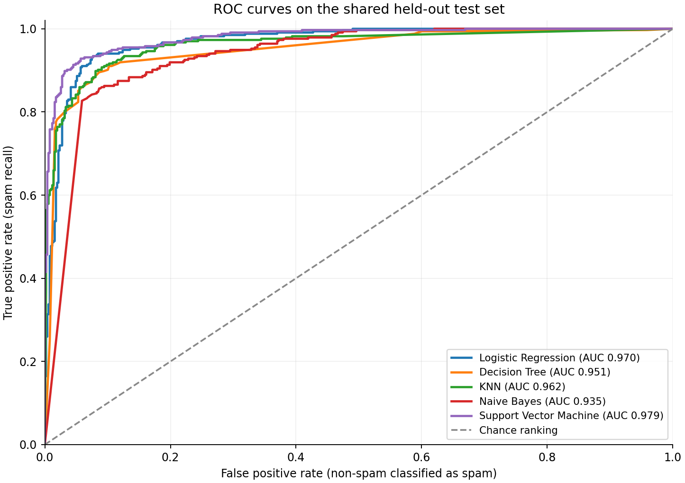
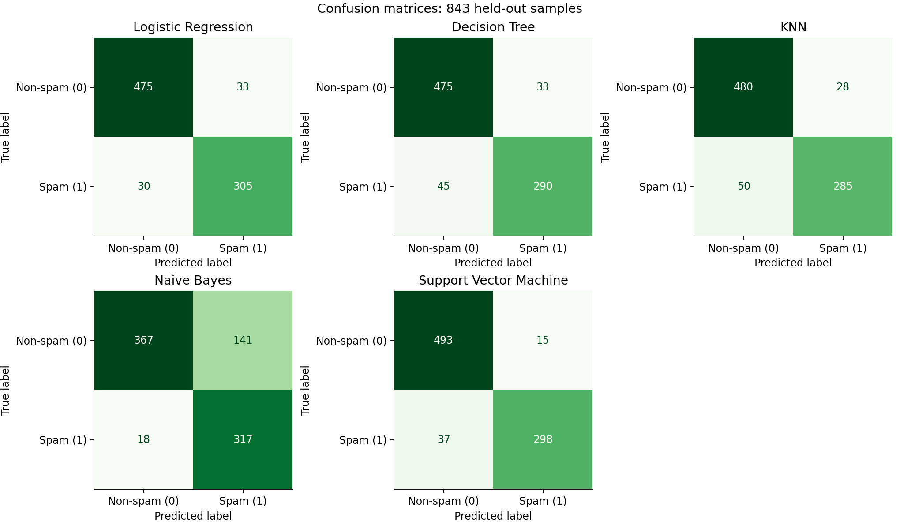

# a. Problem statement

Classify an email as **spam (1)** or **non-spam (0)** from 57 numeric statistics describing word frequency, character frequency, and capital-letter runs. This project implements the five classifiers, compares their predictions on one held-out dataset, and provides a Streamlit interface for evaluating saved models.

The application accepts a labelled CSV of the numeric features. It does not accept raw email text or calculate these statistics from a mailbox. Built-in scikit-learn estimators, preprocessing, model-selection functions, and evaluation metrics are used as permitted by the assignment clarification.

# b. Dataset description

| Item                       | Description                                                                                                                             |
| -------------------------- | --------------------------------------------------------------------------------------------------------------------------------------- |
| Dataset                    | [Spambase, UCI Machine Learning Repository](https://archive.ics.uci.edu/dataset/94/spambase)                                            |
| Authors                    | Mark Hopkins, Erik Reeber, George Forman, Jaap Suermondt                                                                                |
| Citation                   | Hopkins et al. (1999), DOI: [10.24432/C53G6X](https://doi.org/10.24432/C53G6X)                                                          |
| Licence                    | [Creative Commons Attribution 4.0 International](https://creativecommons.org/licenses/by/4.0/)                                          |
| Original samples           | 4,601 emails: 2,788 non-spam and 1,813 spam                                                                                             |
| Input features             | 57 numeric inputs, excluding the target: 48 word-frequency percentages, 6 character-frequency percentages, and 3 capital-run statistics |
| Target column              | `spam`: `0 = non-spam`, `1 = spam`                                                                                                      |
| Missing values             | The retained raw file has no missing or nonfinite values; see the source-documentation discrepancy in `data/SOURCE.md`                  |
| Duplicate policy           | Remove 391 identical full rows; retain conflicting labels and group identical input vectors during splitting                            |
| Prepared samples           | 4,210 rows: 2,531 non-spam and 1,679 spam; 4,207 unique input vectors                                                                   |
| Conflicting feature groups | Three input vectors each have both labels; all six rows are retained                                                                    |
| Training data              | 3,367 rows: 2,023 non-spam and 1,344 spam                                                                                               |
| Held-out test data         | 843 rows: 508 non-spam and 335 spam                                                                                                     |
| Split                      | Approximately 80/20, using the first fold of seeded five-fold `StratifiedGroupKFold`, `random_state=42`                                 |
| Assignment minimum         | Meets at least 12 input features and 500 instances                                                                                      |

The original headerless, comma-separated file is retained at `data/raw/spambase.data`. Official feature names and order are defined in `spambase/config.py` and documented in `data/feature_dictionary.csv`. The prepared full dataset is `data/spambase.csv`; the same `test_data.csv` is used for every classifier. The target and audit identifiers are excluded from model inputs.

[data/SOURCE.md](data/SOURCE.md) records attribution, original files, checksums, and transformations.

# d. Models used

| Required model         | scikit-learn implementation           | Preprocessing           |
| ---------------------- | ------------------------------------- | ----------------------- |
| Logistic Regression    | `LogisticRegression`                  | `StandardScaler`        |
| Decision Tree          | `DecisionTreeClassifier`              | Original numeric values |
| KNN                    | `KNeighborsClassifier`                | `StandardScaler`        |
| Naive Bayes            | `GaussianNB`                          | `StandardScaler`        |
| Support Vector Machine | `SVC(kernel="rbf", probability=True)` | `StandardScaler`        |

Every scaler is fitted inside its model's `Pipeline`. Cross-validation learns preprocessing from each training fold, and the selected pipeline is refitted on the full training portion. The held-out test set does not contribute scaling statistics or parameter choices. Each saved `.joblib` file contains the complete fitted preprocessing/model pipeline.

Identical feature vectors share a group independently of their labels. The outer split keeps groups together, and five-fold `StratifiedGroupKFold` inside `GridSearchCV` keeps groups together during parameter selection. This prevents repeated inputs from straddling training and validation/test partitions while preserving the three conflicting-label pairs.

The search optimises **binary F1 for spam (positive class 1)** on training folds. Parameter grids are explicit in `spambase/training.py`, and candidate scores are saved under `results/cv/`. The overall winner is selected by the highest mean training CV F1. The held-out comparison is reported after this selection and is not used for retuning.

## Evaluation metrics

All five saved models are evaluated on the same 843 held-out rows. Precision, recall, and F1 refer to **spam = 1**, using binary averaging. AUC means ROC AUC from continuous `P(spam)` scores, rather than predicted labels. Metrics are proportions rounded to four decimals below; `results/model_comparison.csv` retains additional precision. MCC ranges from -1 to 1.

| ML Model Name          | Accuracy |    AUC | Precision | Recall |     F1 |    MCC |
| ---------------------- | -------: | -----: | --------: | -----: | -----: | -----: |
| Logistic Regression    |   0.9253 | 0.9697 |    0.9024 | 0.9104 | 0.9064 | 0.8442 |
| Decision Tree          |   0.9075 | 0.9508 |    0.8978 | 0.8657 | 0.8815 | 0.8060 |
| KNN                    |   0.9075 | 0.9625 |    0.9105 | 0.8507 | 0.8796 | 0.8059 |
| Naive Bayes            |   0.8114 | 0.9353 |    0.6921 | 0.9463 | 0.7995 | 0.6569 |
| Support Vector Machine |   0.9383 | 0.9792 |    0.9521 | 0.8896 | 0.9198 | 0.8711 |

The test set contains 508 non-spam and 335 spam emails. Always predicting non-spam would achieve 0.6026 accuracy but zero spam recall/F1, demonstrating why the other metrics matter.

## Observations about model performance

| ML Model Name                     | Observation about model performance                                                                                                                                                                                                                                                                                                         |
| --------------------------------- | ------------------------------------------------------------------------------------------------------------------------------------------------------------------------------------------------------------------------------------------------------------------------------------------------------------------------------------------- |
| Logistic Regression               | Accuracy 0.9253 and F1 0.9064 provide a strong linear baseline. It detects 305 of 335 spam emails, misses 30, and incorrectly flags 33 non-spam emails. Its spam recall (0.9104) exceeds SVM's, while its precision (0.9024) is lower. The selected configuration uses `C=10.0` and balanced class weights.                                 |
| Decision Tree                     | Accuracy 0.9075 and F1 0.8815 are below Logistic Regression and SVM. It detects 290 spam emails, with 45 false negatives and 33 false positives. The selected tree uses maximum-depth parameter 8 and at least 8 samples per leaf.                                                                                                          |
| KNN                               | The selected 11-neighbour distance-weighted model has accuracy 0.9075, matching the tree, but F1 is slightly lower at 0.8796. It makes fewer false positives (28) but misses more spam emails (50). Precision 0.9105 and recall 0.8507 show this different error balance.                                                                   |
| Naive Bayes                       | Highest spam recall (0.9463): 317 of 335 spam emails are detected and only 18 are missed. However, 141 non-spam emails are flagged as spam, reducing precision to 0.6921, accuracy to 0.8114, and F1 to 0.7995. AUC remains 0.9353. The Gaussian/conditional-independence baseline therefore shows a substantial precision-recall tradeoff. |
| Support Vector Machine            | Highest test accuracy (0.9383), AUC (0.9792), precision (0.9521), F1 (0.9198), and MCC (0.8711). It flags only 15 non-spam emails incorrectly, while missing 37 spam emails. Its recall (0.8896) is below Logistic Regression and Naive Bayes. The selected RBF model uses `C=8.0`, `gamma=0.01`.                                           |
| Overall, winner for this dataset? | **Support Vector Machine**, selected by the highest training CV F1 (0.9098), also leads held-out F1 (0.9198). Logistic Regression is a competitive alternative with higher spam recall. SVM's advantage is an observation from this experiment; no statistically established superiority is claimed.                                        |

## Cross-validation and selected parameters

These values come only from the 3,367 training rows. Standard deviation describes the five folds for the selected configuration; it is not a confidence interval.

| ML Model Name          | Mean CV F1 | CV F1 standard deviation | Selected parameters                |
| ---------------------- | ---------: | -----------------------: | ---------------------------------- |
| Logistic Regression    |     0.9057 |                   0.0130 | `C=10.0, class_weight=balanced`    |
| Decision Tree          |     0.8710 |                   0.0175 | `max_depth=8, min_samples_leaf=8`  |
| KNN                    |     0.8803 |                   0.0163 | `n_neighbors=11, weights=distance` |
| Naive Bayes            |     0.8057 |                   0.0057 | `var_smoothing=1e-07`              |
| Support Vector Machine |     0.9098 |                   0.0099 | `C=8.0, gamma=0.01`                |

The source consists of emails collected in 1999, and its non-spam examples include personal/work correspondence with collection-specific indicators such as `george`, `hp`, and `650`. A grouped split prevents overlap of identical inputs; it does not establish separation by sender, campaign, or time. Scores on current or unrelated email collections may differ. The parameter grids and seed were not changed in response to the held-out scores.





## Run locally

Use Python 3.11-3.13; this local environment uses Python 3.13. Keep the dependency versions in `requirements.txt` compatible with the saved model environment. From the project folder:

```bash
python3 -m venv .venv
source .venv/bin/activate
python -m pip install -r requirements.txt
python train.py
python evaluate.py
python -m streamlit run app.py
```

On Windows, activate with `.venv\Scripts\activate`. The bundled raw data lets `python train.py` run offline after installing dependencies. `python train.py --download` optionally refreshes the official UCI files and requires internet access.

The existing local environment and newly trained artifacts are ready to rerun directly:

```bash
.venv/bin/python train.py
.venv/bin/python evaluate.py
.venv/bin/python -m streamlit run app.py
```

The app opens at the local URL printed by Streamlit, normally `http://localhost:8501`. It evaluates the packaged test data by default. Upload a labelled feature CSV to evaluate all five saved pipelines on the same uploaded rows, then select a classifier to inspect its metrics, confusion matrix, classification report, and prediction download. The app never retrains on uploaded rows.

An uploaded CSV needs all 57 feature names plus the `spam` target, using `0` for non-spam and `1` for spam. Column order may differ. Every value must be finite and numeric. Validation rejects missing/extra columns, duplicate headers, malformed rows, missing values, and text in numeric fields. The limits are 10 MB and 20,000 rows. If only one target class is present, AUC is shown as `N/A`; undefined precision/recall/F1 divisions and a constant-label MCC use zero following the code's scikit-learn conventions.

Additional terminal examples:

```bash
python evaluate.py --csv test_data.csv --model svm
python evaluate.py --csv test_data.csv --output results/custom_evaluation.csv
```

## Project files

```text
app.py                            Streamlit evaluation interface
train.py                          Training entry point
evaluate.py                       Saved-model evaluation entry point
spambase/config.py                Feature schema, target and settings
spambase/data.py                  Source loading, audit, deduplication and group IDs
spambase/training.py              Grouped splitting/CV, fitting, exports and plots
spambase/evaluation.py            Shared CSV validation and metrics
requirements.txt                  Pinned runtime dependencies
requirements-dev.txt              Runtime dependencies plus pytest
pytest.ini                        Test discovery restricted to the active tests directory
test_data.csv                     Shared held-out test data with spam target
data/raw/spambase.data           Unchanged official source data
data/raw/spambase.names          Original ordered feature definitions
data/raw/spambase.DOCUMENTATION  Original dataset documentation
data/raw/uci_metadata.json       Retained official API response
data/spambase.csv                Prepared dataset after exact-row deduplication
data/splits/train_data.csv       Training portion for reproducibility
data/feature_dictionary.csv      Feature descriptions and target definition
data/SOURCE.md                   Dataset provenance and licence
model/*.joblib                   Five fitted preprocessing/model pipelines
model/metadata.json             Parameters, counts, package versions and checksums
results/model_comparison.csv    All six held-out metrics for all five models
results/cross_validation_summary.csv  Training CV F1 summary
results/cv/*.csv                 Hyperparameter candidate scores
results/evaluation_details.json Per-model matrices, reports and predictions
results/test_predictions.csv    Actual labels and all model predictions/probabilities
results/data_audit.json          Counts, duplicate policy and raw checksum
results/split_manifest.csv      Source positions, feature groups and train/test membership
results/cv_fold_manifest.csv    Training groups and validation-fold assignments
results/figures/                 ROC curves and confusion-matrix plots
tests/                          Workflow and Streamlit AppTest checks
WALKTHROUGH.md                   Explanation of the code and evaluation choices
SUBMISSION_CHECKLIST.md          Remaining repository, cloud, lab and PDF steps
```

Source positions and feature-group identifiers are audit fields, not predictors. `.venv/`, `tmp/`, bytecode, caches, and secrets are excluded by `.gitignore`. Keep the source, `model/`, `test_data.csv`, and runtime dependencies in the repository for deployment.

## Verification

```bash
python -m pip install -r requirements-dev.txt
python -m pytest -q
python -m pip check
```

The Spambase run passed **29 automated checks** covering train/test and validation-group separation, saved-model metric reproduction, CSV validation, single-class AUC, and Streamlit AppTest rendering/model switching without fitting. Reloading all five saved models through `python evaluate.py` reproduced the 30 reported metric values. `pytest.ini` restricts test discovery to the active `tests/` directory. The app's actual browser/server launch and Community Cloud deployment must be verified in their intended environments; this session's sandbox previously blocked binding a local HTTP port.
